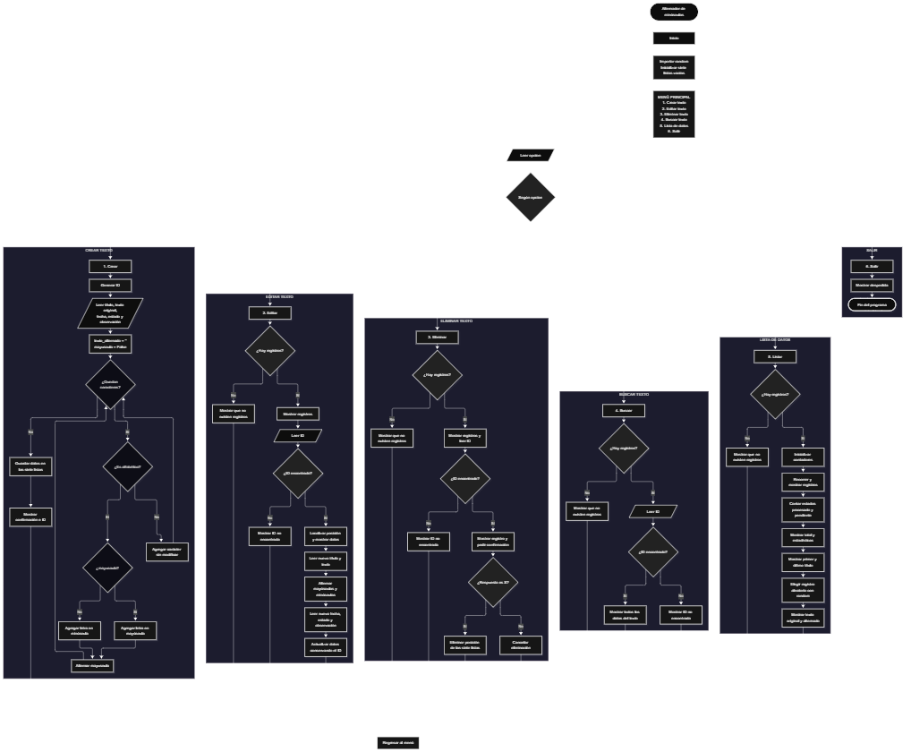

 

Este proyecto, llamado <b>alternador de minúsculas</b>, fue desarrollado en <b>python</b> como un ejercicio práctico para fortalecer la lógica de programación mediante la creación de un sistema de transformación y gestión de textos desde la consola. El programa cuenta con un menú principal de seis opciones que permite <b>crear, editar, eliminar, buscar y listar textos registrados</b>, además de finalizar la ejecución. Cada registro almacena un identificador, un título, el texto original, el texto alternado, una fecha, un estado y una observación, utilizando siete listas paralelas para organizar la información durante la ejecución. La transformación consiste en alternar entre minúsculas y mayúsculas en cada carácter alfabético, comenzando por una letra minúscula y conservando los espacios, números y signos de puntuación sin modificar la alternancia. Durante su desarrollo se aplicaron conceptos fundamentales de programación, como variables, listas, estructuras condicionales, ciclos repetitivos, manejo de cadenas de texto, búsqueda de registros y eliminación de elementos. Este proyecto permite poner en práctica los conocimientos adquiridos en Python y sirve como base para desarrollar aplicaciones de procesamiento y gestión de textos más avanzadas.

<h2 align="center">⚙️ Funcionamiento del menú principal</h2>

### ➕ Crear texto

La opción <b>1) crear texto</b> permite registrar un nuevo texto y generar automáticamente su versión alternada. Primero, el programa comprueba si la lista <b>ids</b> está vacía mediante la condición <b>len(ids) == 0</b>. Si no existen registros, asigna el identificador <b>1</b>; de lo contrario, obtiene el siguiente identificador sumando uno al último elemento de la lista mediante <b>ids[-1] + 1</b>. Después, solicita el <b>título, texto original, fecha, estado y observación</b>. Para transformar el contenido, inicializa la variable <b>texto_alternado</b> como una cadena vacía y la variable lógica <b>mayuscula</b> con el valor <b>False</b>. A continuación, recorre los caracteres del texto original mediante un ciclo <b>for</b> y comprueba si cada carácter es una letra utilizando <b>isalpha()</b>. Si es alfabético, lo convierte a minúscula o mayúscula según el estado de la variable y después invierte dicho estado mediante <b>mayuscula = not mayuscula</b>. Si el carácter no es alfabético, lo agrega sin modificarlo y conserva el estado actual de la alternancia. Finalmente, almacena todos los datos en sus respectivas listas y muestra los mensajes <b>"texto registrado correctamente."</b> y el identificador asignado.

### ✏️ Editar texto

La opción <b>2) editar texto</b> permite modificar la información de un registro existente. Primero, comprueba si la lista <b>ids</b> está vacía; si no existen registros, muestra el mensaje <b>"no existen registros."</b>. En caso contrario, recorre las listas y presenta los datos almacenados de cada texto. Después, solicita el identificador del registro mediante la variable <b>id_buscar</b> y comprueba si está presente en la lista <b>ids</b>. Si lo encuentra, obtiene su posición utilizando <b>ids.index(id_buscar)</b> y muestra la información actual. A continuación, solicita el nuevo título y el nuevo texto original. El programa vuelve a ejecutar el procedimiento de alternancia, comenzando nuevamente por una letra minúscula, y actualiza las listas <b>titulos, textos_originales, textos_alternados, fechas, estados y observaciones</b>. El identificador permanece sin cambios. Finalmente, presenta el mensaje <b>"registro actualizado correctamente."</b>. Si el identificador no existe, muestra <b>"id no encontrada."</b>.

### 🗑️ Eliminar texto

La opción <b>3) eliminar texto</b> permite eliminar un registro mediante su identificador. Antes de comenzar, el programa comprueba si existen registros almacenados. Si las listas están vacías, muestra el mensaje <b>"no existen registros."</b>. Si hay datos disponibles, presenta todos los registros y solicita el identificador que se desea eliminar. Cuando encuentra el identificador, utiliza <b>ids.index(id_buscar)</b> para obtener su posición y muestra los datos correspondientes. Después, solicita confirmación mediante la pregunta <b>"¿desea eliminar este registro? (s/n): "</b>. Si la respuesta es <b>"S"</b> o <b>"s"</b>, la condición <b>respuesta.upper() == "S"</b> se cumple y el programa elimina los elementos de esa posición mediante el método <b>pop()</b> en las siete listas. De esta forma, los datos relacionados con el registro se eliminan de manera coordinada. Finalmente, muestra <b>"registro eliminado correctamente."</b>. Si la respuesta no es afirmativa, presenta <b>"el registro no fue eliminado."</b>. Si el identificador introducido no existe, muestra <b>"id no encontrada."</b>.

### 🔎 Buscar texto

La opción <b>4) buscar texto</b> permite localizar un registro utilizando su identificador. Primero, comprueba si existen textos registrados. Si no hay información almacenada, presenta el mensaje <b>"no existen registros."</b>. En caso contrario, solicita el identificador mediante la variable <b>id_buscar</b> y comprueba si está presente en la lista <b>ids</b>. Si existe, obtiene la posición correspondiente con <b>ids.index(id_buscar)</b> y muestra todos los datos asociados: identificador, título, texto original, texto alternado, fecha, estado y observación. Si el identificador no se encuentra en la lista, presenta el mensaje <b>"id no encontrada."</b>. Esta operación facilita la consulta individual de los textos sin necesidad de recorrer visualmente toda la lista de registros.

### 📋 Lista de datos

La opción <b>5) lista de datos</b> permite visualizar todos los registros y consultar estadísticas sobre los textos almacenados. Primero, el programa comprueba si existen registros. Si las listas están vacías, muestra <b>"no existen registros."</b>. Si hay datos disponibles, inicializa las variables <b>procesados</b> y <b>pendientes</b> en cero y utiliza un ciclo <b>for</b> para recorrer todos los registros. Durante el recorrido, presenta los datos de cada texto y comprueba su estado mediante las condiciones <b>estados[i].lower() == "procesado"</b> y <b>estados[i].lower() == "pendiente"</b>. De esta manera, cuenta los registros que coinciden con esos estados sin distinguir entre mayúsculas y minúsculas. Después, muestra la cantidad total de textos mediante <b>len(ids)</b>, los textos procesados, los pendientes, el primer título mediante <b>titulos[0]</b> y el último mediante <b>titulos[-1]</b>. Finalmente, utiliza <b>random.randint(0, len(ids) - 1)</b> para seleccionar una posición aleatoria y presentar una demostración que compara el texto original con el texto alternado correspondiente. Esta opción combina la consulta general de los registros con un resumen estadístico y una demostración de la transformación realizada.

### 🚪 Salir del menú principal

La opción <b>6) salir</b> permite finalizar la ejecución del programa. Cuando el usuario selecciona esta opción, se muestra el mensaje <b>"gracias por utilizar el alternador de minúsculas."</b> y se ejecuta la instrucción <b>break</b>, que interrumpe el ciclo <b>while True</b> del menú principal. De esta manera, el programa deja de solicitar opciones y termina su ejecución. Si el usuario introduce una opción diferente de los valores comprendidos entre <b>1</b> y <b>6</b>, se ejecuta el bloque <b>else</b> y se muestra el mensaje <b>"opción no válida."</b>, permitiendo continuar utilizando el menú.

<h2 align="center">🧠 Temas aplicados en el proyecto</h2>

### 📦 Variables

En este proyecto se utilizan variables para controlar la opción seleccionada en el menú, generar identificadores, almacenar los datos introducidos por el usuario, transformar los textos, localizar registros y calcular estadísticas. Cada variable cumple una función específica dentro de las operaciones de gestión y transformación de la información.

🔢 **opcion:** Almacena la opción seleccionada por el usuario en el menú principal.

🆔 **id_texto:** Contiene el identificador asignado al nuevo registro.

🔎 **id_buscar:** Almacena el identificador introducido para localizar un registro.

📍 **posicion:** Indica la posición de un registro dentro de las listas.

📝 **titulo:** Almacena el título introducido para un texto.

📄 **texto_original:** Contiene el texto original que se desea transformar.

🔠 **texto_alternado:** Almacena el resultado de alternar minúsculas y mayúsculas.

🔄 **mayuscula:** Variable lógica que controla si la siguiente letra debe convertirse a mayúscula o a minúscula.

📅 **fecha:** Almacena la fecha asociada al registro.

📌 **estado:** Contiene el estado introducido para el texto.

💬 **observacion:** Almacena la observación asociada al registro.

🔢 **procesados:** Cuenta los registros cuyo estado es procesado.

⏳ **pendientes:** Cuenta los registros cuyo estado es pendiente.

🔁 **i:** Funciona como contador para recorrer las listas durante la edición, eliminación y visualización de registros.

🎲 **respuesta:** Almacena la respuesta del usuario para confirmar o cancelar la eliminación de un registro.

### 🗃️ Listas

El programa utiliza siete listas paralelas para almacenar y organizar la información de los textos. Todas las listas utilizan la misma posición para representar los datos relacionados con un registro. Por ejemplo, los elementos ubicados en la posición <b>0</b> de las siete listas corresponden al mismo texto. Esta estructura permite agregar, editar, buscar, mostrar y eliminar registros manteniendo la relación entre sus datos. Las listas se almacenan en memoria durante la ejecución del programa y no se utiliza almacenamiento permanente en archivos o bases de datos.

🆔 **ids:** Almacena los identificadores de los textos registrados.

📝 **titulos:** Guarda los títulos asociados a cada texto.

📄 **textos_originales:** Contiene los textos originales introducidos por el usuario.

🔠 **textos_alternados:** Almacena las versiones transformadas de los textos originales.

📅 **fechas:** Guarda las fechas asociadas a los registros.

📌 **estados:** Almacena los estados de los textos, como procesado o pendiente.

💬 **observaciones:** Contiene las observaciones asociadas a cada registro.

### 🔀 Estructuras condicionales

En este proyecto se utilizan las estructuras <b>if, elif y else</b> para controlar las operaciones del menú principal y decidir qué instrucciones deben ejecutarse según la opción seleccionada. También permiten comprobar si existen registros, determinar si un identificador está presente en la lista, seleccionar la conversión correspondiente para cada letra, decidir si un registro debe eliminarse y clasificar los textos según su estado. Estas condiciones permiten que el programa responda de manera diferente según los datos almacenados y las acciones realizadas por el usuario.

### 🔄 Estructuras repetitivas

El programa utiliza el ciclo <b>while True</b> para mantener activo el menú principal hasta que se selecciona la opción de salida. También emplea ciclos <b>for</b> para recorrer los caracteres del texto original y los registros almacenados en las listas. El recorrido de los caracteres permite construir el texto alternado, mientras que los recorridos de los registros permiten mostrar la información y calcular las estadísticas. La instrucción <b>break</b> interrumpe el ciclo principal cuando el usuario selecciona la opción de salir.

### 🔤 Manejo de cadenas de texto

El procesamiento de cadenas constituye la función principal del proyecto. Para construir el texto alternado, se utiliza una cadena vacía en la que se agrega cada carácter procesado. El método <b>isalpha()</b> permite determinar si un carácter es una letra, mientras que los métodos <b>lower()</b> y <b>upper()</b> permiten convertirlo a minúscula o mayúscula. La variable lógica <b>mayuscula</b> cambia de valor después de cada letra para alternar la conversión. Los caracteres que no son alfabéticos se agregan directamente al resultado y no cambian el estado de la alternancia. Por ejemplo, el texto <b>"Hola, Mundo 123!"</b> se transforma en <b>"hOlA, mUnDo 123!"</b>. Este procedimiento se aplica tanto al crear un texto como al editarlo.

### 🎲 Módulo random

El proyecto incorpora el módulo <b>random</b> mediante la instrucción <b>import random</b>. Este módulo se utiliza en la opción de lista de datos para seleccionar aleatoriamente uno de los registros existentes. La función <b>random.randint(0, len(ids) - 1)</b> genera un número entero entre la primera posición válida y la última posición ocupada de las listas. El número obtenido se almacena en la variable <b>posicion</b> y permite mostrar el texto original junto con su versión alternada. Esta demostración se ejecuta únicamente cuando existen registros, evitando seleccionar una posición de una lista vacía.

### 🔍 Búsqueda mediante identificadores

Para localizar un registro, el programa utiliza el operador <b>in</b> para comprobar si el identificador introducido se encuentra en la lista <b>ids</b>. Cuando existe una coincidencia, el método <b>index()</b> obtiene la posición del identificador dentro de la lista. Esa posición se utiliza para acceder a los datos correspondientes en las demás listas. Este procedimiento se aplica en las operaciones de edición, eliminación y búsqueda, permitiendo trabajar directamente con el registro seleccionado.

### 🧮 Conteo y estadísticas

La opción de lista de datos utiliza la función <b>len()</b> para calcular la cantidad de registros almacenados. Además, las variables <b>procesados</b> y <b>pendientes</b> se incrementan durante el recorrido de las listas cuando el estado de un registro coincide con las categorías correspondientes. El programa también consulta el primer y el último título mediante los índices <b>0</b> y <b>-1</b>. Estas operaciones permiten obtener un resumen de los datos sin modificar los registros almacenados.

<h2 align="center">¿Cómo se implementaron las operaciones crud en el proyecto?</h2>

Las operaciones <b>crud</b> se implementaron mediante las opciones del menú principal y permiten administrar los textos almacenados temporalmente en las listas. La operación <b>crear</b> corresponde a <b>crear texto</b>, donde se registran los datos y se genera el texto alternado; <b>leer</b> se realiza mediante <b>buscar texto y lista de datos</b>, que permiten consultar un registro específico o visualizar todos los registros; <b>actualizar</b> corresponde a <b>editar texto</b>, donde se modifican los datos de un registro y se vuelve a calcular el texto alternado; y <b>eliminar</b> se realiza mediante <b>eliminar texto</b>, que solicita confirmación y retira los datos de las siete listas. Estas operaciones utilizan identificadores y posiciones compartidas para mantener organizada la información durante la ejecución del programa.

<h2 align="center">Diagrama de flujo del proyecto</h2>

El diagrama de flujo representa la estructura general del alternador de minúsculas, desde el inicio del programa y la inicialización de las listas hasta la presentación del menú principal. También muestra las seis opciones disponibles, las comprobaciones de registros existentes, la transformación de los caracteres, la gestión de los datos, la generación de estadísticas y el retorno al menú después de cada operación. Finalmente, representa la salida del programa mediante la opción correspondiente.

<h2 align="center">🛡️ Validaciones del programa</h2>

### 📭 No existen registros

Esta comprobación se utiliza en las opciones de <b>editar texto, eliminar texto, buscar texto y lista de datos</b>. El programa verifica si la lista <b>ids</b> está vacía mediante la condición <b>len(ids) == 0</b>. Si no existen registros, muestra el mensaje <b>"no existen registros."</b> y evita continuar con las operaciones que necesitan información almacenada. Esta condición también impide que la opción de estadísticas intente acceder al primer o al último título cuando no hay textos registrados.

### 🔎 Identificador no encontrado

Esta comprobación se utiliza en las opciones de <b>editar texto, eliminar texto y buscar texto</b>. El programa verifica si el identificador introducido mediante <b>id_buscar</b> se encuentra en la lista <b>ids</b>. Si existe, obtiene su posición y continúa con la operación correspondiente. Si no existe, muestra el mensaje <b>"id no encontrada."</b>. De esta manera, evita realizar cambios o consultas sobre un identificador que no corresponde a un registro almacenado.

### 🗑️ Confirmación de eliminación

Antes de eliminar un registro, el programa muestra sus datos y solicita confirmación al usuario. La condición <b>respuesta.upper() == "S"</b> permite aceptar tanto la letra <b>s</b> minúscula como la letra <b>S</b> mayúscula. Si la respuesta coincide, se eliminan los datos correspondientes de las siete listas. Si la respuesta es diferente, el registro se conserva y se muestra el mensaje <b>"el registro no fue eliminado."</b>.

### 🔠 Transformación de caracteres

Durante la transformación, el programa comprueba cada carácter mediante <b>isalpha()</b>. Si el carácter es una letra, se convierte según el valor de la variable <b>mayuscula</b>, que alterna entre <b>False</b> y <b>True</b>. Si el carácter no es alfabético, se agrega sin modificarlo y no se invierte la variable de control. Esta lógica permite conservar los espacios, números y signos de puntuación, alternando únicamente las letras del texto original.

### 📌 Clasificación de estados

En la opción de lista de datos, el programa compara los estados almacenados utilizando el método <b>lower()</b>. De esta manera, valores como <b>"procesado"</b> y <b>"PROCESADO"</b> se contabilizan dentro de la misma categoría. Lo mismo sucede con el estado <b>"pendiente"</b>. Sin embargo, el programa no valida los estados al momento de registrar o editar un texto, por lo que los valores distintos de esas dos categorías se almacenan, pero no se incluyen en sus contadores estadísticos.

### ⚠️ Entrada numérica del identificador

En las opciones de edición, eliminación y búsqueda, el programa convierte el identificador introducido por el usuario mediante <b>int(input(...))</b>. Esto permite comparar el valor con los identificadores numéricos almacenados en la lista <b>ids</b>. No obstante, el código actual no incluye un manejo de excepciones para entradas no numéricas. Si el usuario introduce letras u otros valores que no pueden convertirse a entero, el programa puede generar un error y detener su ejecución.

### 🔢 Generación de identificadores

El programa asigna el identificador <b>1</b> cuando no existen registros y, cuando hay datos, obtiene el siguiente identificador sumando uno al último elemento de la lista <b>ids</b>. Este procedimiento funciona con el orden actual de los registros, pero no garantiza que siempre se utilice el identificador más alto existente. Si se elimina el último registro, el identificador correspondiente podría volver a utilizarse en el siguiente registro creado. El código actual no incorpora un contador independiente para conservar la secuencia de identificadores después de las eliminaciones.

### ⚠️ Opción no válida

El menú principal utiliza una estructura condicional <b>if, elif y else</b> para determinar qué operación debe ejecutarse. Si el usuario introduce una opción diferente de los valores <b>1, 2, 3, 4, 5 y 6</b>, el bloque <b>else</b> muestra el mensaje <b>"opción no válida."</b>. Como el menú está dentro de un ciclo <b>while True</b>, el programa vuelve a mostrar las opciones y permite realizar otro intento.

<h2 align="center">🎯 Objetivo del proyecto</h2>

El objetivo principal de este proyecto es fortalecer la <b>lógica de programación</b> mediante el desarrollo de una aplicación de consola en <b>python</b> capaz de transformar textos y gestionar sus registros. A través de su construcción se ponen en práctica conocimientos sobre variables, listas paralelas, estructuras condicionales, ciclos repetitivos, métodos para manipular cadenas de texto y operaciones de búsqueda, edición y eliminación. Además, la implementación de estadísticas y la selección aleatoria de un registro permiten ampliar el uso de los datos almacenados. Este proyecto constituye una base para comprender el procesamiento de cadenas y la administración de información, y puede servir como punto de partida para desarrollar herramientas de texto más completas utilizando otros lenguajes y tecnologías.

